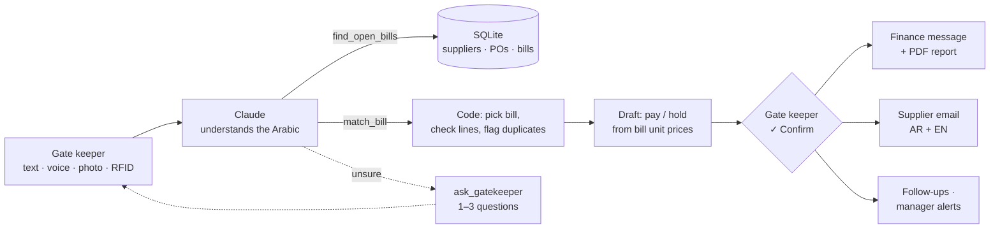

# WAKEEL وكيل — the goods-receiving agent

**HUMAIN Hackathon · Challenge 3 · Autonomous Enterprise**

Today a person checks every delivery by hand at the warehouse gate and carries the result to finance.
**WAKEEL listens to the gate keeper in plain Saudi Arabic, finds the right bill, checks every item, and tells finance exactly what to pay and what to hold.** The gate keeper only confirms with one tap.

> Version 1 is a working prototype on demo data: physical equipment deliveries, 3 suppliers, 9 bills.

---

## What it does

| The gate keeper… | WAKEEL… |
|---|---|
| says, types, or photographs what arrived<br>*"وصلت من شركة أ: الطابعة والمكتب وثلاث شاشات، وحدة منها مكسورة. الماوس ما وصل."* | finds the right open bill among all of the supplier's bills (**A-1042**), and marks every line: received, partial, missing, damaged, or wrong model |
| | decides the money from the bill's own prices: **pay 4,200 SAR, hold 1,100 SAR** (1 monitor damaged × 900 + 1 mouse missing × 200) |
| taps **✓ Confirm** | saves the receiving record, notifies finance, drafts the Arabic + English supplier email, makes a PDF receiving report, sets follow-ups in 7 days, and alerts the manager only for exceptions |

**Inputs:** text, voice 🎤 (browser speech-to-text, `ar-SA`), photo of the delivery note 📷, and a simulated RFID gate scan 📡. All four feed the same agent.

### The messy cases it handles

| Situation | What WAKEEL does |
|---|---|
| Same item on two open bills | Uses the other items, quantities and bill dates to pick one; if still unsure, asks **one** question with bill buttons |
| Partial delivery (6 of 10 chairs) | Pays for what arrived, holds the rest, keeps the bill open |
| Wrong model (Samsung instead of Dell) | Flags a substitution, holds that line, alerts procurement |
| One delivery, two bills | Splits it into two receiving records |
| Item already received / more than ordered | Flags a possible duplicate before anyone pays twice |
| Item not on any bill | Flags an unexpected item |
| Voice not heard clearly | Does not guess: asks up to 3 short questions with tap answers |

---

## How the agent works



**Design principle: the model understands; code decides money.**
- Claude (`claude-opus-5-5`, tool use) reads the Saudi-dialect sentence, photo, or speech guesses and turns them into structured items (`{item: MON, delivered: 3, damaged: 1}`).
- Deterministic tools (`wakeel/tools.py`) choose the bill, compute every line, and calculate pay/hold as **quantity × the bill's unit price**. Every held riyal is traced to a bill line.
- Nothing is saved, paid or sent until the gate keeper confirms. WAKEEL recommends; finance approves the actual payment.

**Two engines, same tools.** If there is no API key or no internet, an **offline rule-based Arabic parser** (`wakeel/parser.py`) takes over, so the demo cannot fail. Photo reading needs Claude.

| Agent tool | What it does |
|---|---|
| `find_open_bills` | All open bills for a supplier, with outstanding quantities and prices |
| `match_bill` | Picks the right bill line(s), splits across bills, flags duplicates / unexpected items, or asks one question |
| `ask_gatekeeper` | Asks 1–3 short questions with answer buttons when the input is unclear |
| `propose_receiving` / `decide_payment` | Builds the draft and the pay/hold amounts |
| `confirm_delivery` → `create_receiving_record`, `notify_finance`, `draft_supplier_email`, `schedule_followup` | Runs after the one tap |
| `build_report` | One-page PDF receiving report (Arabic + English) |

---

## Evidence: test results

19 test deliveries with **23 planted problems** (missing, damaged, partial, wrong model, split, duplicate, unexpected item, unclear bill, unknown supplier, RFID, English input). A case passes only if the bill, every line status, and the exact pay/hold amounts are right.

| Run | Cases passed | Planted problems caught | No-touch share* | Avg agent time |
|---|---|---|---|---|
| Claude — first run | 17 / 19 | 21 / 23 | 15 / 19 | 10.0 s |
| Claude — after fix | **19 / 19** | **23 / 23** | 17 / 19 | 10.3 s |
| Offline backup engine | 19 / 19 | 23 / 23 | 17 / 19 | 0.01 s |

\* Reached the confirm screen with no question. The two that ask (T07, T17) are on purpose: there is no way to tell the bill or the supplier, so WAKEEL asks instead of guessing.

**What failed and how we fixed it.** In the first run Claude *asked the gate keeper* about items that were not on any open bill, instead of running our duplicate check, so 2 duplicates / unexpected items were not flagged. We changed one rule: the agent must always pass every item to `match_bill`, which also checks closed bills and receiving history. The safety check now always runs in code.

**Honest caveat.** The 19 cases were written together with the offline parser, so its 19/19 is optimistic. `tests/team_cases.json` holds sentences written separately by the team; the offline parser already fails one of them ("كرسيين فيهم كسر"), which is why the AI engine matters. Full tables: [`tests/`](tests/).

---

## Run it

Requires Python 3.10+ and (for the AI engine) an Anthropic API key.

```bash
python -m venv .venv
.venv\Scripts\activate          # Windows   (macOS/Linux: source .venv/bin/activate)
pip install -r requirements.txt
copy .env.example .env          # then put your ANTHROPIC_API_KEY in .env
python -m wakeel.db             # create the demo database
python app.py                   # http://localhost:8000
```

- **Gate keeper screen** (mobile, Arabic): http://localhost:8000/gate — use Google Chrome for voice.
- **Finance screen** (desktop): http://localhost:8000/finance — payment decisions, PDF reports, alerts, follow-ups, email drafts, impact numbers. *Reset demo data* is at the top.

Run the tests:

```bash
python run_trials.py offline                         # free, instant
python run_trials.py claude                          # ~3 min, a few dollars
python run_trials.py claude tests/team_cases.json    # the team's own sentences
```

Step-by-step checks: `python step2_check.py` (tools only, no AI) and `python step3_check.py` (Arabic understanding).

Optional real email: add the `WAKEEL_GMAIL_*` settings from `.env.example` (needs a Gmail app password). Without them, emails stay as drafts. Supplier emails only ever go to a test inbox, never to a supplier's real address.

---

## Project structure

```
app.py               web server (FastAPI): gate + finance screens and API
wakeel/agent.py      the agent: Claude tool-use loop + offline engine
wakeel/tools.py      bill matching, pay/hold, receiving record, finance, email, follow-ups
wakeel/parser.py     offline Saudi-dialect parser (backup)
wakeel/db.py         SQLite schema + demo data (company · item · qty · order date · expected date · unit price · total)
wakeel/report.py     PDF receiving report (Arabic + English)
wakeel/mailer.py     Gmail sender (optional)
web/                 gate.html (mobile, RTL) · finance.html (desktop)
tests/               test deliveries, team cases, sample delivery-note images, results
run_trials.py        runs the test set and scores it
```

---

## Current limitations

- **Demo data only:** SQLite with 3 suppliers and 9 bills; no ERP connection, no real payments.
- **Emails are drafts** unless Gmail is configured; no automatic supplier reply handling.
- **Voice** uses the browser's free speech service: Chrome only, needs internet, and dialect words and numbers are sometimes mis-heard (mitigated by sending 5 guesses to the agent and asking when unsure).
- **Offline parser** only knows fixed word lists; new phrasings fail (the AI engine handles them).
- **Follow-ups** are not merged or closed automatically when the missing item later arrives.
- **Time saved** is measured only on screen; the manual baseline still has to be measured with our mentor.
- **Agent memory** for a delivery lives in server memory; restarting the server mid-delivery loses the conversation (confirmed data is safe in the database).
- **Services** (cleaning, consulting) and **real RFID hardware** are out of scope for version 1.

## Next improvements

- A server-side Arabic speech model tuned for Saudi dialect (e.g. HUMAIN's ALLaM direction), so voice works on any device.
- ERP connection and HUMAIN ONE marketplace integration; real email and supplier replies.
- Real RFID / barcode readers posting to the same endpoint the RFID button uses today.
- Late-delivery alerts from the stored expected delivery dates; supplier reliability scores from receiving history.
- Damage photos attached to the receiving report automatically.
- Data kept inside the Kingdom, in line with PDPL.

---

*All suppliers, bill numbers, items and prices are demo data.*
